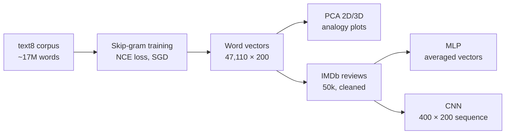
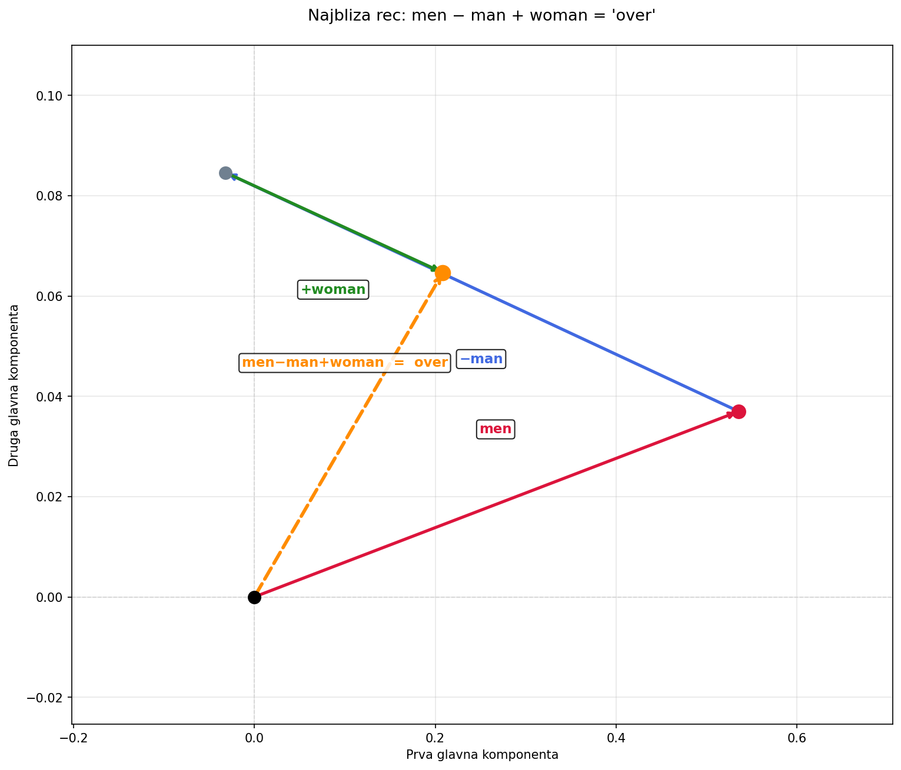
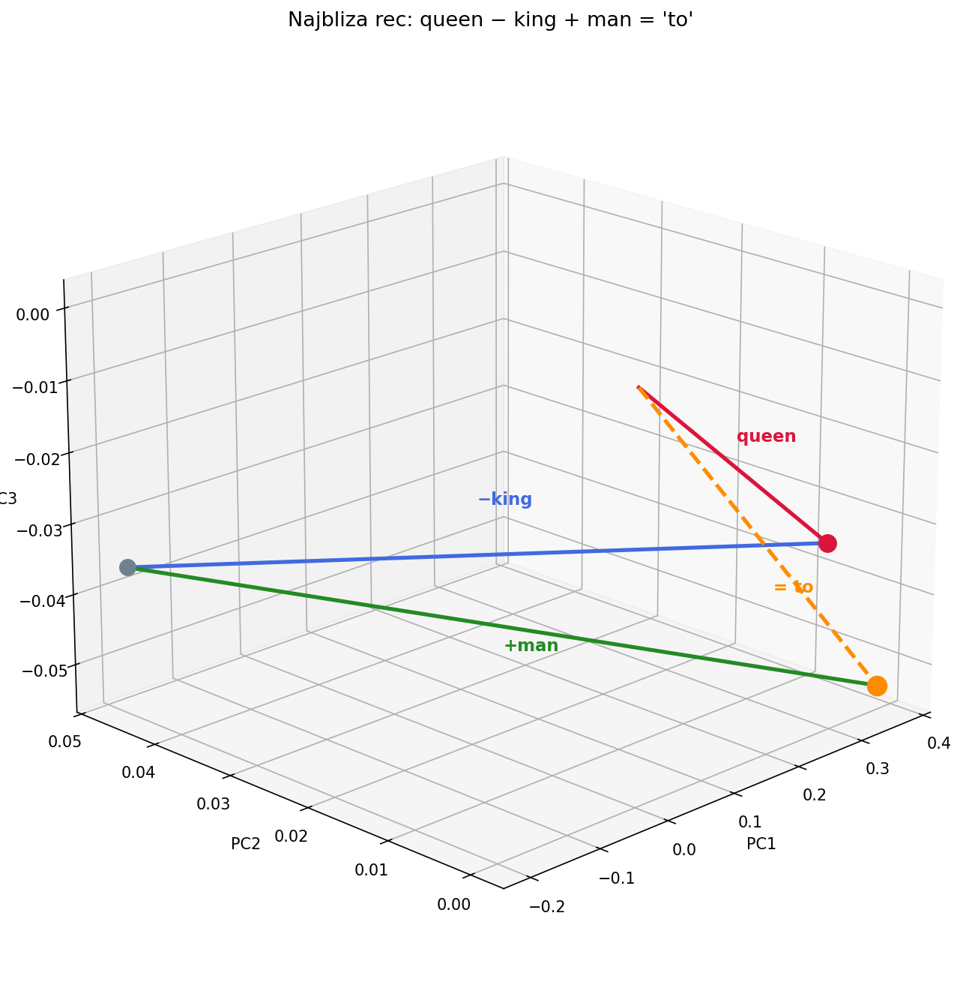

# Detecting Positive and Negative Reviews Using Word Vectors


> Trained my own Skip-gram Word2Vec embeddings (200-d) on the text8 Wikipedia corpus and used them to classify 50,000 IMDb movie reviews as positive or negative. **Best model: 1-layer Convolutional Neural Network (CNN), F1 = 0.865** (Multilayer Perceptrons (MLP) baseline on averaged vectors: F1 = 0.711).

**Context:** University course project, *Methods and Techniques of Data Science* (3rd year, undergraduate).

**Tools:** Python, TensorFlow/Keras, scikit-learn (PCA), NumPy, pandas, Matplotlib.

**Natural Language Processing pipeline in Python for sentiment classification of movie reviews:**



---

## Contents

- [Project Structure](#project-structure)
- [Data](#data)
- [Running](#running)
- [Methodology](#methodology)
- [Results](#results)
- [Conclusion](#conclusion)
- [Ideas for Improvement](#ideas-for-improvement)
- [References](#references)

---

## Project Structure

```
projekat_ceo/
├── README.md
├── requirements.txt                         # Python dependencies
├── skipgram_trening/
│   ├── preuzimanje_text8.py                 # downloads the text8 corpus into text8_dataset/
│   ├── skipgram_trening.py                  # Skip-Gram training (NCE, SGD) → vectors.txt
│   └── grafici_skipgram.py                  # training loss plots for models M1–M6
├── skipgram_vektori/
│   ├── skipgram_pca_analogije.py            # normalization, PCA (2D/3D), analogies and plots
│   ├── vectors.zip                          # learned Skip-Gram vectors (47,110 words × 200 dimensions), unzip to vectors.txt
│   ├── varijansa.txt                        # explained variance of PCA components
│   └── grafici/                             # generated analogy plots (2D and 3D)
│       ├── men_man_woman_women1.png
│       ├── men_man_woman_women2.png
│       ├── queen_king_man_woman1.png
│       ├── queen_king_man_woman2.png
│       └── ...
└── imdb_klasifikacija/
    ├── klasifikacija_sentimenta_mlp.py      # IMDb dataset cleaning + multilayer perceptrons (MLP)
    ├── klasifikacija_sentimenta_cnn.ipynb   # IMDb dataset cleaning + convolutional networks (CNN)
    ├── grafici_cnn.py                       # result plots for CNN models M1–M5
    └── vectors.zip                          # same Skip-Gram vectors, unzip to vectors.txt
```

`vectors.txt` (~100 MB) is over GitHub's file size limit, so it is stored as `vectors.zip`. Unzip it in the folder before running the scripts:

```bash
cd skipgram_vektori && unzip vectors.zip && cd ..
cd imdb_klasifikacija && unzip vectors.zip && cd ..
```

`vectors.txt` is in the text word2vec format: the first line is `47110 200` (number of words and dimensions), and each following line contains a word and its 200 values. Unknown words are mapped to the `UNK` token.

---

## Data

| Dataset | Description | Source |
|---|---|---|
| **text8** | A portion of Wikipedia text, ~17 million words (~250,000 unique), collected by Matt Mahoney in 2006. Lowercase letters and spaces only; numbers are spelled out as words, punctuation removed. | [mattmahoney.net/dc/text8.zip](http://mattmahoney.net/dc/text8.zip) (direct download, used by `preuzimanje_text8.py`); mirror: [kaggle.com/datasets/yorkyong/text8-zip](https://www.kaggle.com/datasets/yorkyong/text8-zip) |
| **IMDb** | 50,000 movie reviews (Stanford), each labeled as positive or negative. Contains punctuation, upper and lower case letters, numbers and HTML line-break tags. | [kaggle.com/datasets/lakshmi25npathi/imdb-dataset-of-50k-movie-reviews](https://www.kaggle.com/datasets/lakshmi25npathi/imdb-dataset-of-50k-movie-reviews) |

The datasets are not included in the repository because of their size. text8 is downloaded automatically by `preuzimanje_text8.py`; `IMDB Dataset.csv` must be downloaded manually from the Kaggle link above.

---

## Running

### Dependencies

```bash
pip install -r requirements.txt
```

Drawing model diagrams (`plot_model`) also needs **Graphviz** (`sudo apt install graphviz` on Linux).

### Skip-Gram Training

```bash
cd skipgram_trening
python preuzimanje_text8.py      # downloads text8_dataset/text8.zip from http://mattmahoney.net/dc/text8.zip
python skipgram_trening.py       # trains the model (current configuration = M4)
```

The script prints the loss every 10,000 iterations and the nearest words for the test words every 100,000 iterations, saves intermediate vectors at the checkpoints, and saves the final vectors as `vectors.txt`. Copy that file into `skipgram_vektori/` and `imdb_klasifikacija/`. Training runs on the CPU and takes several hours; the already trained vectors are included as `vectors.zip`, so this step can be skipped.

`grafici_skipgram.py` draws the training loss of the six configurations from the recorded values (it does not need the corpus).

### PCA and Analogies

```bash
cd skipgram_vektori
python skipgram_pca_analogije.py
```

The script loads `vectors.txt`, normalizes the vectors, runs PCA to 2 and 3 dimensions, computes analogies and saves:
- `varijansa.txt`: explained variance of the components
- `poredjenja.txt`: analogy results
- PNG plots for each analogy (`queen_king_man_woman1–4.png`, etc.)

### Multilayer Perceptron (IMDb)

1. Download `IMDB Dataset.csv` from [Kaggle](https://www.kaggle.com/datasets/lakshmi25npathi/imdb-dataset-of-50k-movie-reviews) and place it in `imdb_klasifikacija/`. Unzip `vectors.zip` in the same folder.
2. Run:

```bash
cd imdb_klasifikacija
python klasifikacija_sentimenta_mlp.py
```

The script cleans and tokenizes the reviews, replaces unknown words with `UNK`, splits the data 80/20 into training and validation sets (with equal numbers of positive and negative reviews), trains three MLP models for 10 epochs each and saves:
- plots `modeli_accuracy_loss.png`, `poredjenje_validacionog_gubitka.png`, `poredjenje_f1.png`, `tabela_rezultata.png`
- plot `poredjenje_validacije.png` and model diagrams `arhitektura_model1–3.png`
- training history `istorija_model1.csv`, `istorija_model2.csv`, `istorija_model3.csv`

### Convolutional Neural Network (IMDb)

With [`IMDB Dataset.csv`](https://www.kaggle.com/datasets/lakshmi25npathi/imdb-dataset-of-50k-movie-reviews) and the unzipped `vectors.txt` in `imdb_klasifikacija/`, open the notebook and run the cells in order:

```bash
cd imdb_klasifikacija
jupyter notebook klasifikacija_sentimenta_cnn.ipynb
```

Each review is cut or padded to 400 tokens, and the input is a 400 × 200 matrix of word vectors. The notebook trains five CNN models (M1–M5) for 10 epochs each and prints their metrics. Training on the CPU is slow (several hours for all five models).

`grafici_cnn.py` draws the comparison plots of the CNN models from the recorded results (it does not need the dataset).

---

## Methodology

- **Text processing:** tokenization, removal of HTML tags and non-letter characters, lowercasing, removal of words that appear too rarely in the text8 corpus.
- **Skip-Gram (Word2Vec):** negative sampling with the **NCE** loss function, **SGD** optimizer, 200-dimensional vectors.
- **Normalization and PCA:** normalization of the vectors to unit length (L2) and PCA reduction to 2D and 3D for visualization.
- **Multilayer perceptron (MLP):** the input is the average vector of all words in the review.
- **Convolutional neural network (CNN):** the input is the sequence of word vectors; **Adam** optimizer.

---

## Results

### Skip-Gram Model

6 configurations were trained, each for 700,000 iterations (one iteration is one batch).

| Parameter | M1 | M2 | M3 | M4 | M5 | M6 |
|---|---|---|---|---|---|---|
| context radius | 3 | 4 | 5 | 3 | 4 | 5 |
| negative sample count | 64 | 64 | 64 | 128 | 128 | 128 |
| words per target | 2 | 2 | 2 | 2 | 2 | 2 |

- *context radius*: number of words around the center word
- *negative sample count*: number of words outside the context radius used for training
- *words per target*: number of words picked from the context radius for one training example

**Nearest words after training, model M4 (best):**

| Word | Nearest words |
|---|---|
| five | three, four, six, eight, seven, two, nine, one |
| of | the, its, including, and, within, most, for, from |
| going | being, out, this, began, means, however, that, research |
| hardware | way, data, free, greek, same, more, type, through |
| american | born, english, john, british, french, film, german, william |
| britain | island, house, third, national, first, british, became, country |

All models show a sharp drop in loss during the first ~20,000 iterations (~18,000 iterations are needed for one pass through the corpus), and reach a plateau after 700,000 iterations. **M4 was chosen as the best** because of its lowest loss and the most meaningful word groups. Numbers and conjunctions cluster together in all models due to their high frequency in text8. Verbs, technical terms and nationality–country relationships are harder, and M4 captures them best thanks to its larger number of negative samples.

### PCA Dimensionality Reduction

Analogies are computed by adding vectors in the original 200-dimensional space, and the result and the nearest word are then projected into 2D and 3D.

| Projection | Retained variance |
|---|---|
| 2D | 2.09% |
| 3D | 2.66% |

Vector arithmetic in the 200-dimensional space does not give the exact expected words (for `queen − king + man` the expected result is `woman`, but `to` was obtained; `woman` is ranked 646th of 47,110), and the 2D/3D projections keep too little variance to be used for arithmetic. Still, vector directions continue to show semantic geometry, e.g. the singular–plural relationship (*man–men*, *woman–women*).

Tested analogies (plots are in [`skipgram_vektori/grafici/`](skipgram_vektori/grafici/)):
- `queen − king + man ≈ woman`
- `men − man + woman ≈ women`
- `better − good + bad ≈ worse`
- `japanese − japan + spain ≈ spanish`
- `went − go + come ≈ came`

<p align="center">
  
  
</p>

### Multilayer Perceptron

| Model | Hidden layers (neurons) | Architecture | F1 / epochs |
|---|---|---|---|
| Model 1 | 2 (128, 64) | Decreasing | 0.6697 / 10 |
| Model 2 | 3 (128, 256, 128) | Arch | 0.6935 / 10 |
| Model 3 | 4 (256, 128, 64, 32) | Pyramid | **0.7113** / 10 |

Validation accuracy ranges from 67% to 71%. The pyramid-shaped Model 3 gives the best result. The limitation of this architecture is that it only looks at the average vector of a review, so it does not take word order into account.

### Convolutional Neural Network

| Model | Conv. layers (filters) / kernel | Dense layers / neurons | F1 / epochs |
|---|---|---|---|
| M1 | 1 (128) / 3 | 1 / 64 | **0.8648** / 10 |
| M2 | 2 (128, 64) / 3, 3 | 1 / 64 | 0.8599 / 7 |
| M3 | 2 (128, 64) / 5, 3 | 1 / 64 | 0.8219 / 2 |
| M4 | 4 parallel (128) / 2, 3, 4, 5 | 1 / 128 | 0.5005 / 1 |
| M5 | 4 parallel (128) / 2, 3, 4, 5 | 1 / 128 | 0.856 / 10 |

- **M1**, the simplest, is also the best. Adding sequential layers (M2, M3) brings no improvement, and for M2 the validation accuracy drops after the 7th epoch.
- **M4 → M5:** the parallel multi-kernel model (M4) failed to learn (F1 0.50), because average pooling at the branch junction blurred the signal. Removing the output-halving layer and switching to **max** pooling (M5) let each branch keep the strongest signal for its pattern length (2–5 words), raising F1 to **0.856**.

---

## Conclusion

- **Skip-Gram** learned clear word clusters (numbers, nationalities), but the small text8 corpus limited analogy accuracy, which points to larger corpora or contextual models as the next step.
- **PCA** is good for showing semantic geometry between word pairs, but not for arithmetic over the reduced vectors.
- **Multilayer perceptrons** achieve satisfactory results given their simplicity, but are not precise enough for practical use.
- **Convolutional model M1** (F1 0.8648) achieves a very good result compared to similar work, taking into account the differences in data.

---

## Ideas for Improvement

- A larger and richer corpus for training the vectors, or contextual models such as **BERT** or **ELMo** (multiple vectors per word, depending on context).
- Additional training of the Skip-Gram model on IMDb data, to better cover words specific to movie reviews.
- A larger set of reviews, which would allow larger convolutional models. Computing power is also a limitation.
- The MLP could be slightly improved with more layers and more data, but not significantly, since it does not see word order.

---

## References

1. M. S. Başarslan, F. Kayaalp, *MBi-GRUMCONV: A novel Multi Bi-GRU and Multi CNN-Based deep learning model for social media sentiment analysis*, 2023. [ResearchGate](https://www.researchgate.net/publication/366991905_MBi-GRUMCONV_A_novel_Multi_Bi-GRU_and_Multi_CNN-Based_deep_learning_model_for_social_media_sentiment_analysis)
2. T. Musil, *Examining Structure of Word Embeddings with PCA*. [arXiv:1906.00114](https://arxiv.org/pdf/1906.00114)
